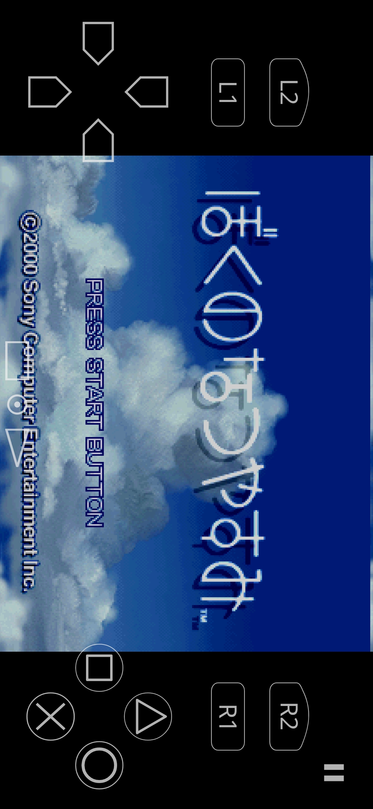
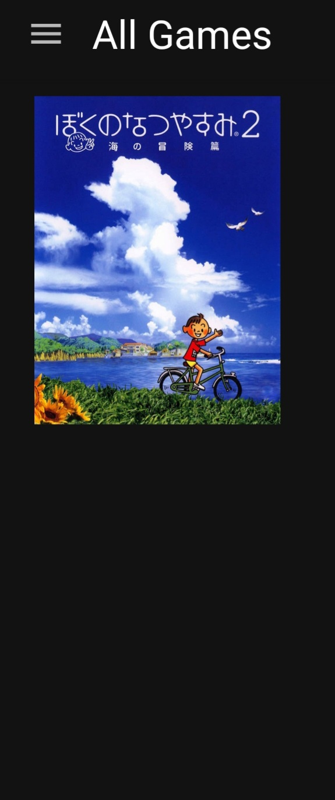
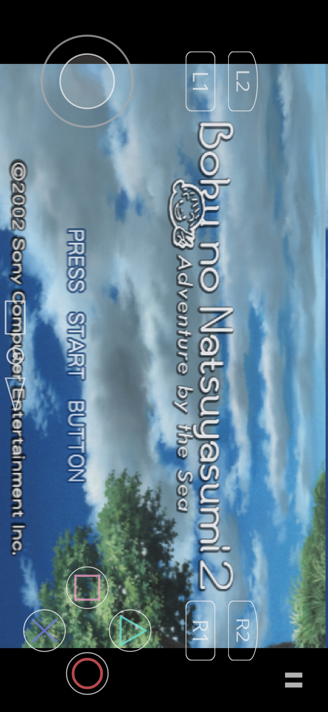

Android requirements for both Boku no Natsuyasumi 1 & 2:

## PS1 ENG Port

Duckstation (SCPH1001.BIN) -> Boku no Natsuyasumi (Japan) [T-En boku-ps1 v1].chd

  
  

## PS2 ENG Port

NetherSX2 (SCPH-70012_BIOS_V12_USA_200.BIN) -> Boku no Natsuyasumi 2 (English v1.2) [zlib].chd

  
  

